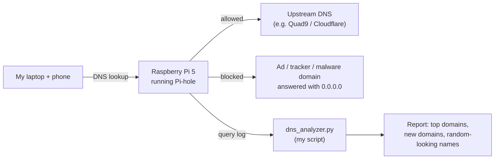

# Pi DNS Lab

> A Raspberry Pi that watches the DNS lookups from my own devices, blocks ads, trackers and known-bad domains, and flags anything unusual.

<!-- Keep that first line simple enough for someone outside tech to understand. -->

**Status:** 🚧 In progress (started October 2026)

---

## Why I built this

_TODO: 2–3 sentences in your own words. Example: I'm an IT student interested in network defense. I wanted hands-on experience with DNS, Linux and log analysis using real traffic I generated myself instead of a tutorial dataset._

## How it works

Every website and app starts with a DNS lookup ("what's the IP address for example.com?"). When the Pi answers those lookups for my devices, it keeps a log of everything they try to reach. I can then block or investigate whatever doesn't belong.

## Hardware & software

| Item | Details |
|---|---|
| Board | Raspberry Pi 5 (1GB RAM) |
| Storage | microSD (_TODO: size_) |
| Network | House Wi-Fi (no Ethernet available) |
| OS | Raspberry Pi OS Lite (64-bit), headless |
| DNS filtering | Pi-hole |
| Analysis | Python 3 |
| Hardening | SSH keys only, ufw firewall, fail2ban |

## Project phases

- [ ] **Phase 1: Setup.** Headless install, SSH, Pi-hole for my own devices. [docs/01-setup.md](docs/01-setup.md)
- [ ] **Phase 2: Log analysis.** A Python script that flags unusual domains. [docs/02-log-analysis.md](docs/02-log-analysis.md)
- [ ] **Phase 3: Hardening.** Lock down the Pi and review login attempts. [docs/03-hardening.md](docs/03-hardening.md)
- [ ] **Phase 4 (next semester):** Forward logs to a SIEM running on my laptop.

Session-by-session notes: [docs/lab-notebook.md](docs/lab-notebook.md)

## Findings

_TODO: Fill this in as you go. Recruiters read this section first. Examples:_
- _Over X days my devices made N DNS queries, and Y% were blocked._
- _The most-contacted domain was ___ (it belongs to ___)._
- _My script flagged ___, which turned out to be ___._

| Screenshot | What it shows |
|---|---|
| _(add later)_ `screenshots/dashboard.png` | Pi-hole dashboard after one week |

## Skills demonstrated

- Linux administration (headless setup, SSH, package management, services)
- Networking (DNS, IP addressing, Wi-Fi troubleshooting)
- Security monitoring (DNS logs, anomaly detection)
- System hardening (key-based auth, host firewall, brute-force protection)
- Python scripting (log parsing and analysis)
- Technical documentation

## What I learned

_TODO: Write this at the end. Cover what broke, how you fixed it and what you'd do differently._

## Privacy note

This repo contains **no raw DNS logs**. A real log shows every site a device visits, so all sample data here is trimmed and anonymized: device IPs are replaced and personal domains are removed. The Pi only handles DNS for my own devices, nobody else's on the network.
