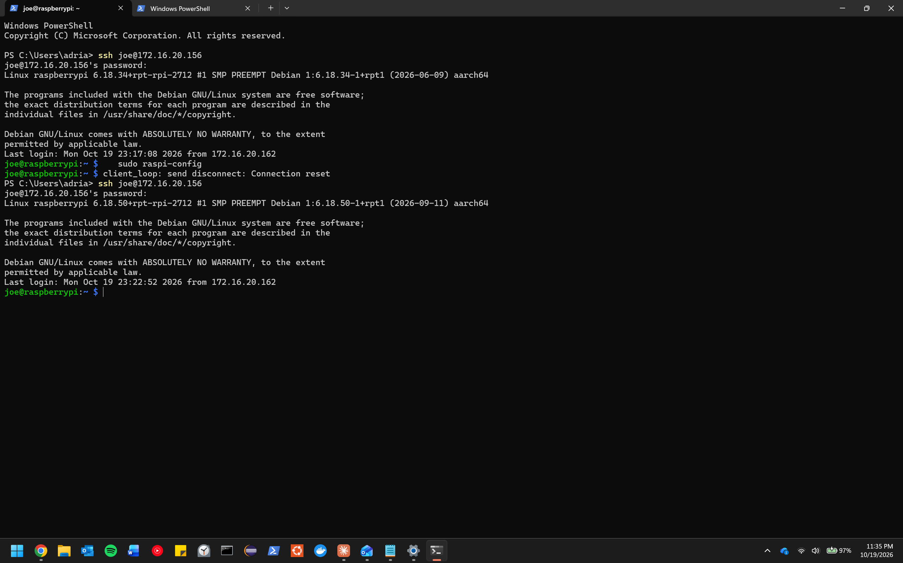

# Phase 1: Setup

**Goal:** The Pi boots headless on house Wi-Fi, I can SSH in from my laptop, and Pi-hole answers DNS for my own laptop and phone.

## Checklist

### Before first boot
- [X] Flash **Raspberry Pi OS (64-bit)** with Raspberry Pi Imager. I meant to use Lite but ended up with the desktop version, so I set it to boot to the console instead.
- [X] Fill in Imager's customization settings: hostname, username/password, Wi-Fi name and password, Wi-Fi country = US, time zone = America/Chicago
- [X] Turn on SSH, choose public-key authentication, and paste in my public key (`~/.ssh/id_ed25519.pub`)

### First boot
- [X] Wait 2–3 minutes, then SSH in: `ssh <Adrian>@<hostname>.local`
- [X] Update everything: `sudo apt update && sudo apt full-upgrade -y`
- [X] Write down the Pi's IP address: `hostname -I`
- [X] If SSH is laggy, turn off Wi-Fi power saving: `sudo iw wlan0 set power_save off`

### Pi-hole
- [X] Install Pi-hole using the official docs (docs.pi-hole.net). The quick install is `curl -sSL https://install.pi-hole.net | bash`. Piping a script into bash means trusting the source, and the docs also show how to download it and read it first.
- [X] Save the web admin password somewhere safe
- [ ] Point **my laptop's** DNS at the Pi's IP
- [ ] Point **my phone's** DNS at the Pi's IP (iPhone: Settings → Wi-Fi → ⓘ → Configure DNS → Manual; on Android it's in the Wi-Fi network's IP settings). Tried this on 2026-10-21 and it broke my phone's internet, so my phone is moving to Pi-hole over Tailscale instead: [04-remote-access.md](04-remote-access.md)
- [ ] Confirm my queries show up in the Pi-hole dashboard
- [ ] Learn how to switch my devices back to automatic DNS in case the Pi goes down

## What I actually did

_Write the real steps here, including anything that didn't go to plan._

## Problems & fixes

| Problem | Cause | Fix |
|---|---|---|
| iPhone showed "No Internet Connection" after I set its Wi-Fi DNS to the Pi's IP | Not confirmed: the Pi's IP may have changed (no DHCP reservation), client isolation on the house Wi-Fi, phone and Pi on different subnets, or Pi-hole only answering local requests | Set the iPhone's DNS back to Automatic. Switched the phone to Pi-hole over Tailscale ([04-remote-access.md](04-remote-access.md)) |

## Screenshots

_Save images in `screenshots/` and link them here, e.g. ``_
