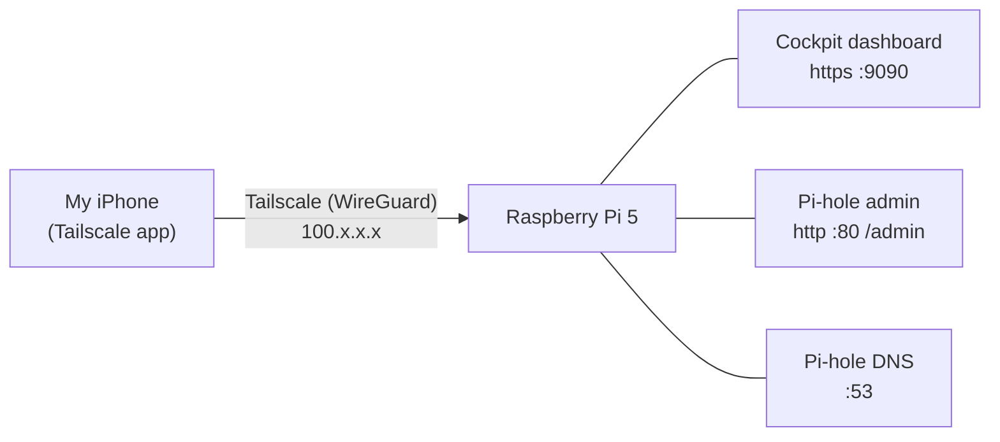

# Phase 4: Remote access & monitoring

**Goal:** Check on and manage the Pi from my phone from anywhere without opening any ports on the house network, and use Pi-hole on my phone both at home and away.

**Why Tailscale:** The Pi is on house Wi-Fi I don't control. I can't set a DHCP reservation, forward ports, or change the router's DNS, and pointing my phone straight at the Pi's Wi-Fi IP didn't work (see Problems & fixes). Tailscale gives the Pi a stable private address that my phone can reach from anywhere, without touching the router.

## How it works



## Checklist

### Tailscale
- [X] Install Tailscale on the Pi: `curl -fsSL https://tailscale.com/install.sh | sh`
- [X] Connect the Pi with `sudo tailscale up` and sign in with the link it prints
- [X] Install the Tailscale app on my iPhone and sign in with the same account
- [ ] Disable key expiry for the Pi (login.tailscale.com → Machines → ⋯ → Disable key expiry) so it doesn't drop off the tailnet after about 6 months
- [ ] Test from cellular: Wi-Fi off, Tailscale on, open `http://<tailscale-ip>/admin`

### Cockpit (web dashboard)
- [X] Install it: `sudo apt install cockpit`
- [X] Log in from Safari on my phone at `https://<tailscale-ip>:9090` with the Pi's Linux user
- [ ] Add it to my iPhone home screen (Share → Add to Home Screen)
- [ ] Check that `pihole-FTL` shows *Running* under Services

### Pi-hole over Tailscale
- [ ] Stop the Pi from using the tailnet's DNS: `sudo tailscale set --accept-dns=false`
- [ ] Let Pi-hole answer Tailscale queries: Settings → DNS → Interface settings → **Permit all origins** (or `sudo pihole-FTL --config dns.listeningMode ALL`)
- [ ] Tailscale admin console → DNS → Add nameserver → Custom → the Pi's Tailscale IP → Save → turn on **Override DNS servers**
- [ ] Set my iPhone's Wi-Fi DNS back to Automatic and confirm queries from my phone's `100.x` address show up in the Query Log
- [ ] Test on cellular too

### Later
- [ ] Install Termius on my iPhone for full SSH sessions over Tailscale
- [ ] Set up a healthchecks.io cron ping every 5 minutes so I get an alert if the Pi goes down

## Notes

### Which IP is which

`hostname -I` lists one address per network connection:

| Looks like | What it is |
|---|---|
| `192.168.x.x` or `10.x.x.x` | The Pi on house Wi-Fi |
| `100.x.x.x` | The Pi on Tailscale (use this one from my phone) |
| Long addresses with colons | IPv6 versions, can be ignored |

```bash
tailscale ip -4                 # Tailscale address only
ip -4 -br addr show wlan0       # Wi-Fi address only
```

### Same IP, different ports

The IP is the Pi's address and the port picks which program answers:
- `http://<tailscale-ip>/admin` → Pi-hole (default port 80)
- `https://<tailscale-ip>:9090` → Cockpit

### Why the Pi-hole settings change
- `--accept-dns=false`: Pi-hole is the DNS server, so the Pi itself shouldn't take its DNS settings from the tailnet and end up using itself as its own upstream.
- **Permit all origins**: Tailscale queries arrive on the `tailscale0` interface, and Pi-hole's default "local requests only" mode ignores them.

### Security
- Nothing is port-forwarded to the internet. Cockpit and the Pi-hole admin are only reached over Tailscale.
- Cockpit logs in with the Pi's Linux password, so that password has to be strong even though SSH uses keys.
- "Permit all origins" is only safe because no ports are exposed to the internet.
- Safari's certificate warning on Cockpit is expected, since it uses a self-signed certificate.
- Trade-off: while Tailscale is on, my phone depends on the Pi for DNS. If the Pi is down, turning Tailscale off restores normal DNS.

## What I actually did

On 2026-10-21 I tried pointing my iPhone's Wi-Fi DNS at the Pi, which broke my phone's internet, so I switched it back to Automatic. Then I installed Tailscale on the Pi and my iPhone, installed Cockpit, and logged into the Cockpit dashboard from my phone over Tailscale. I started setting up Pi-hole as the DNS server for my whole tailnet.

## Problems & fixes

| Problem | Cause | Fix |
|---|---|---|
| iPhone showed "No Internet Connection" after I set its Wi-Fi DNS to the Pi's Wi-Fi IP | Not confirmed. Possibly the Pi's IP changed (no DHCP reservation), phone and Pi on different subnets, client isolation on the house Wi-Fi, or Pi-hole only answering local requests | Set the iPhone's DNS back to Automatic and switched to Pi-hole over Tailscale |
| `hostname -I` showed several IPs and I didn't know which was the Pi's | The Pi has one address per network connection: Wi-Fi, Tailscale and IPv6 | `tailscale ip -4` prints only the Tailscale address |
| Expected the Tailscale IP to just open Pi-hole | Each program listens on its own port | Cockpit is at `https://<tailscale-ip>:9090` |
| Cockpit asked for the "server user account" | It means the Pi's own Linux login, not my Tailscale or Pi-hole login | Logged in with my Pi username (`whoami`) and password |
| 2026-10-23: SSH from my laptop timed out, and the Tailscale app showed the Pi as offline | Not confirmed. The Pi dropped off the network (possibly Wi-Fi power saving or a power issue) | Restarted the Pi and it came back online. Next: check `vcgencmd get_throttled` and turn off Wi-Fi power saving permanently |

## Screenshots

_Ideas: Cockpit overview on my phone, Tailscale Machines page, Pi-hole Query Log showing my phone's `100.x` address. Blur IPs before committing._
